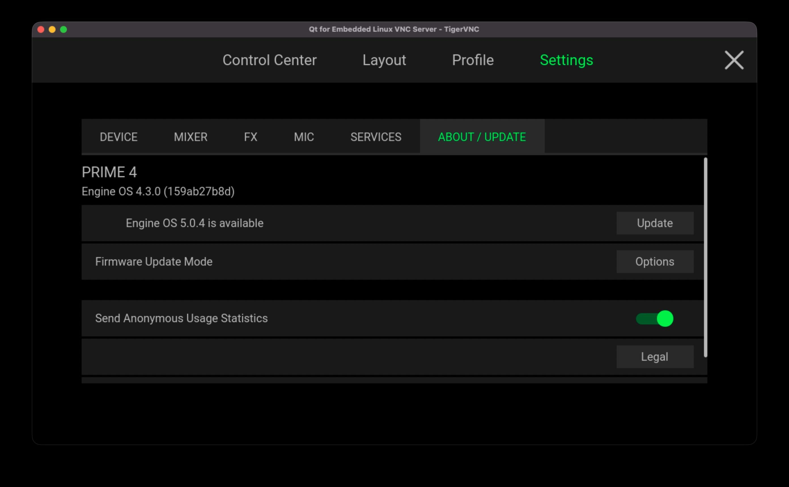
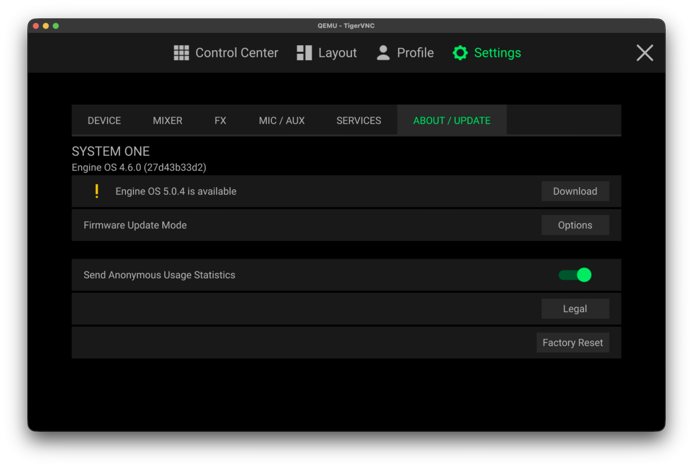
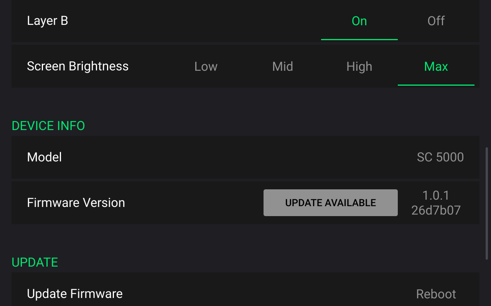
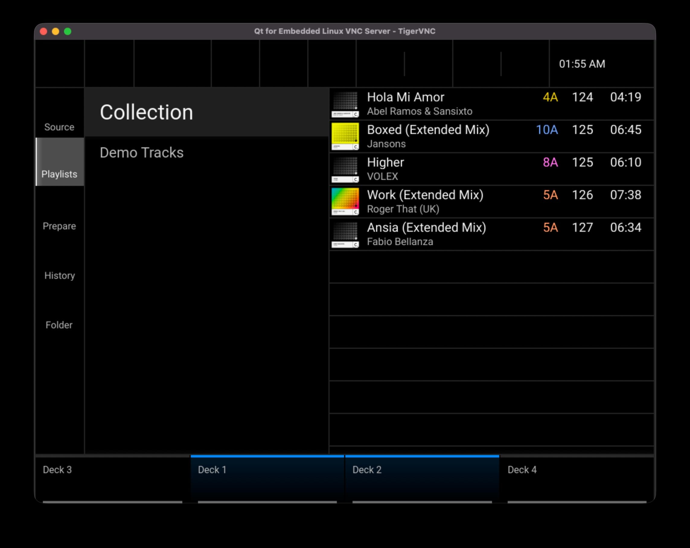
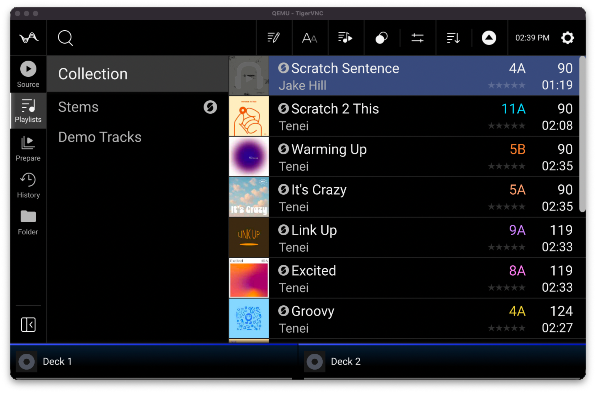
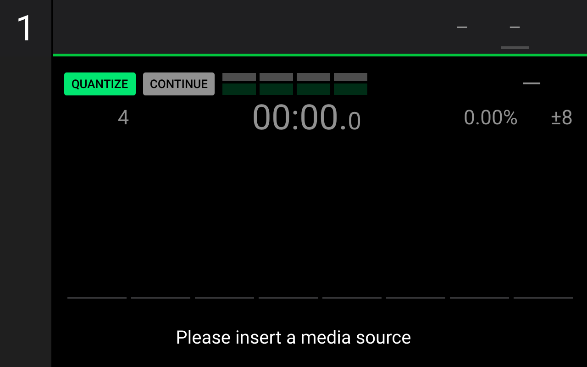

# QEngine - Engine OS Emulator
Emulate Engine OS and other InMusic OSes inside QEMU

**NOTE:** Docs are currently **awful**, they will be better eventually. Basic docs for setting up arn64 emulation are [here.](scripts/build_scripts/BUILD_ARM64.md)

## Documentation
- [BUILDING.md](docs/BUILDING.md) — building/assembling and booting an Engine OS image under QEMU
- [ENGINEOS.md](docs/ENGINEOS.md) — Engine OS internals, product spoofing, known limitations
- [BLOCKING_TELEMETRY.md](docs/BLOCKING_TELEMETRY.md) — stopping Engine's crash/analytics reporting from reaching InMusic's real Sentry project
- [BUILD_ARM64.md](scripts/build_scripts/BUILD_ARM64.md) / [BUILD_ARMV7_ENGINE.md](scripts/build_scripts/BUILD_ARMV7_ENGINE.md) / [BUILD_MPC.md](scripts/build_scripts/BUILD_MPC.md) — what each target needs
- [BUILD_HEADRUSH.md](scripts/build_scripts/BUILD_HEADRUSH.md), building Prime and VX5
- [INSTANCES.md](scripts/build_scripts/INSTANCES.md) — running several emulated devices side by side
- [MACOS_VIRGL.md.md](docs/MACOS_VIRGL.md.md) — Build QEMU w/ Virgl on macOS

## Quick setup

**Prerequisites:** `docker`, `qemu-system-aarch64` and `qemu-system-arm`, `python3`,
`e2fsprogs` (for `dumpe2fs`, `debugfs`, `resize2fs`), `file`.

```sh
# 1. One instance per device + firmware version. Point --firmware straight at an
#    update image, or at the Mac .app zip or Windows .exe updater that carries
#    one; there is no firmware directory to populate. The matching kernel
#    is detected from the rootfs and built on demand -- once per architecture,
#    then reused (~7 min arm64, ~2 min armv7, ~1 min per rootfs).
scripts/build_scripts/new_instance.sh --name rmz2-4.6.0 --device engine \
    --firmware /path/to/SYSTEMONE-4.6.0-Update.img

#    One image usually serves several products, so --product-code picks which one
#    the guest claims to be. It is optional -- each builder has a default -- and it
#    is recorded in instance.env, so a later --force rebuild keeps it.
scripts/build_scripts/new_instance.sh --name mpc-3.9.1 --device mpc \
    --product-code ACV5 --firmware /path/to/MPC-3.9.1-Gen1-update.img

# Engine OS also ships on armv7 (the RK3288 Prime/SC/Mixstream controllers). It is
# the same --device engine, on a different architecture; which builder and disk
# layout it needs is read off the firmware rather than asked for.
scripts/build_scripts/new_instance.sh --name jp07-5.0.4 --device engine \
    --firmware /path/to/JP07-JP08-JP11-5.0.4.img

# Early SC5000 firmware uses Qt VNC with touch and landscape rotation.
scripts/build_scripts/new_instance.sh --name sc5000-1.2.0 \
    --firmware /path/to/SC5000Prime1.2.0Updater-Mac.zip

# 2. Boot. Each instance owns its disks and its host ports, so these run at the
#    same time without interfering.
scripts/qemu/run_instance.sh --name rmz2-4.6.0
scripts/qemu/run_instance.sh --name mpc-3.9.1
scripts/qemu/run_instance.sh --list

# Rendering goes to the host GPU through virgl by default, where QEMU can serve it.
# --no-gl rasterizes on the guest CPU instead, for when GL is what you are ruling out.
scripts/qemu/run_instance.sh --name rmz2-4.6.0 --no-gl
```

The serial console appears in the terminal you launched from and root has no
password.

For SC5000 1.x, connect to the `Engine VNC` address printed by the launcher. QEMU VNC shows the console. These builds use loopback audio and software rendering with missing colored icons; see [BUILD_ARMV7_ENGINE.md](scripts/build_scripts/BUILD_ARMV7_ENGINE.md).

**Build one architecture at a time.** Both pipelines use the same `debian:bookworm`
and `debian:trixie` tags at different architectures, and Docker caches a tag at only
one architecture at a time, so building an arm64 and an armv7 target concurrently
will fight over them. Sequentially is fine — each build pulls what it needs.

**Picking the right firmware.** `--device mpc` covers both MPC images Akai ships, Gen 1 (RK3288, armv7) and Gen 2 (RK3588, arm64), and QEngine reads which one it has off the firmware.

In the MPC guest, failing units for LoadPin verity trustpoints and XMOS USB audio
firmware are expected: none of that hardware exists here. `AZ0x system info logging`
also fails, but for a different and fixable reason — it runs `az0x-info`, which reads
the faked devicetree, and only `acvs.service` carries the `dtshim` preload that makes
that readable. Run it by hand as `LD_PRELOAD=/root/dtshim.so az0x-info` to see what
the application itself resolves.

## Engine OS Support Matrix
|                         | Modern arm64 (4.4.0+) | Modern armv7 (5.0.0+) | Classic (2.4.0-4.3.4) | Legacy (1.0.0-2.3.x) |
|-------------------------|-----------------------|-----------------------|-----------------------|----------------------|
| Engine                  | Y                     | Y                     | Y                     | Y                    |
| SoundSwitch             | Y                     | ?                     | ?                     | ?                    |
| Display                 | Y                     | Y                     | Y                     | Y                    |
| Virgl                   | Y                     | Y                     | Y                     | N                    |
| Fake Touch              | Y                     | Y                     | Y                     | Y                    |
| Keyboard Navigation     | Y                     | ?                     | ?                     | ?                    |
| Audio Playback          | Y                     | N                     | ?                     | ?                    |
| MIDI                    | Y                     | Y                     | ?                     | ?                    |
| External Media (USB/SD) | Y                     | Y                     | ?                     | ?                    |

## Emulated Controllers

The **Code** column is the `inmusic,product-code` devicetree value, which is what
actually selects the device — one firmware image usually serves several products and
`/usr/Engine` is shared across them, so the code is the only thing distinguishing
them (see [ENGINEOS.md](docs/ENGINEOS.md#product-identity-spoofing)). Version cells
hold the exact firmware version booted, `?` for untested, `–` where that major
version was never released for the device.

|                         | Code  | SOC    | Signed FW | Arch  | 1.x         | 2.x   | 3.x   | 4.x           | 5.x         |
|-------------------------|-------|--------|-----------|-------|-------------|-------|-------|---------------|-------------|
| Denon DJ Prime 2        | JC16  | RK3288 | N         | armv7 | 1.5.2, 1.6.2 | ?     | ?     | ?             | 5.3.0       |
| Denon DJ Prime 4        | JC11  | RK3288 | N         | armv7 | 1.3.2-1.4.1, 1.5.2-1.6.2 | 2.4.0 | 3.4.0 | 4.0.0-4.3.0   | 5.3.0       |
| Denon DJ Prime 4+       | JC11S | RK3288 | Y         | armv7 | –           | –     | ?     | ?             | 5.3.0       |
| Denon DJ Prime 4 G2     | JP24  | RK3588 | Y         | arm64 | –           | –     | –     | -             | 5.1.0-5.3.0 |
| Denon DJ Prime GO       | JP11  | RK3288 | N         | armv7 | 1.6.2 !     | ?     | ?     | 4.3.0 !       | 5.3.0 !     |
| Denon DJ Prime GO+      | JP11S | RK3288 | Y         | armv7 | –           | –     | –     | ?             | ?           |
| Denon DJ SC5000 Prime   | JP07  | RK3288 | N         | armv7 | 1.0.1-1.3.1, 1.4.1-1.6.2 | ?     | ?     | ?             | 5.0.4-5.3.0 |
| Denon DJ SC5000M Prime  | JP08  | RK3288 | N         | armv7 | 1.3.1-1.6.0 | ?     | ?     | ?             | 5.3.0       |
| Denon DJ SC6000 Prime   | JP13  | RK3288 | N         | armv7 | 1.5.2, 1.5.3, 1.6.2 | ?     | ?     | ?             | 5.3.0       |
| Denon DJ SC6000M Prime  | JP14  | RK3288 | N         | armv7 | 1.5.2, 1.6.0 | ?     | ?     | ?             | 5.3.0       |
| Denon DJ SC Live 2      | JP20  | RK3288 | Y         | armv7 | –           | 2.3.3 | ?     | ?             | 5.3.0       |
| Denon DJ SC Live 4      | JP21  | RK3288 | Y         | armv7 | –           | ?     | ?     | 4.3.4         | 5.3.0       |
| Numark Mixstream Pro    | NH08  | RK3288 | N         | armv7 | –           | 2.0.1-2.3.2 | ?     | ?             | 5.3.0       |
| Numark Mixstream Pro+   | NH08S | RK3288 | Y         | armv7 | –           | ?     | ?     | ?             | 5.3.0       |
| Numark Mixstream Pro GO | NH10  | RK3288 | Y         | armv7 | –           | –     | ?     | ?             | ?           |
| RANE SYSTEM ONE         | RMZ2  | RK3588 | Y         | arm64 | –           | –     | –     | 4.5.0-4.6.0   | 5.0.4-5.3.0 |

Prime 4 1.3.2 and 1.3.3 render, but the source browser stays open after the startup notice is dismissed. Version 1.4.1 accepted settings-menu touch navigation once; reopening settings after a cold boot remains unresolved. See [armv7 builds](scripts/build_scripts/BUILD_ARMV7_ENGINE.md) for the legacy runtime's limits.

Mixstream Pro 2.0.1 to 2.3.2 boot on the same legacy path as 1.x and need no audio shim. QEngine picks that path for any firmware older than glibc 2.34, so 2.3.x takes it despite running Qt 5.15.2, and renders in software rather than through virgl. The SC media players and Prime GO boot 1.5.2 and later with four-channel playback-only audio configured by QEngine; Prime 2 and Prime 4 start without it. Playback remains unverified. `!` marks Prime GO firmware booted as `JC11`, since as `JP11` its battery gate quits Engine shortly after startup. Prime GO 1.5.2 has the gate built into its own binary and quits even as `JC11`. Prime GO+ as `JP11S` and Mixstream Pro GO as `NH10` on 5.3.0 start Engine, show a blank screen and power the guest off after about two minutes, so those cells stay `?`. Their image boots as `JC11S` and `NH08S`.

## Other inMusic devices

### Emulated MPCs

Same shape as the table above. **Code** is again the `inmusic,product-code` value,
read here from the `model` and `inmusic,product-code` properties of the
`/boot/rk3288-*.dtb` files the firmware ships. Version cells hold the exact firmware
version booted, `?` for untested. The Gen 1 MPCs all ship from one image covering
eight models, so a version column is the *image* version. The six Gen 2 models share one image too, which carries its dtbs in the update image rather than in `/boot`; their codes are read from there.

|                    | Code  | SOC    | Signed FW | Arch  | 2.x | 3.x          |
|--------------------|-------|--------|-----------|-------|-----|--------------|
| MPC X              | ACV5  | RK3288 | 3.x only  | armv7 | ?   | 3.9.1-3.10.0 |
| MPC X SE           | ACV5S | RK3288 | 3.x only  | armv7 | ?   | 3.9.1-3.10.0 |
| MPC XL             | ACVC  | RK3588 | Y         | arm64 | –   | 3.10.0       |
| MPC Live           | ACV8  | RK3288 | 3.x only  | armv7 | ?   | 3.9.1-3.10.0 |
| MPC Live Mk 2      | ACVB  | RK3288 | 3.x only  | armv7 | ?   | 3.9.1-3.10.0 |
| MPC Live III       | ACVG  | RK3588 | Y         | arm64 | –   | 3.10.0       |
| MPC One            | ACVA  | RK3288 | 3.x only  | armv7 | ?   | 3.9.1-3.10.0 |
| MPC One+           | ACVA2 | RK3288 | 3.x only  | armv7 | ?   | 3.9.1-3.10.0 |
| MPC One (Gen 2)    | ACVA3 | RK3588 | Y         | arm64 | –   | 3.10.0       |
| MPC Key 61         | ACVM  | RK3288 | 3.x only  | armv7 | ?   | 3.9.1-3.10.0 |
| MPC Key 61 (Gen 2) | ACVM2 | RK3588 | Y         | arm64 | –   | 3.10.0       |
| MPC Key 37         | ACVR  | RK3288 | 3.x only  | armv7 | ?   | 3.9.1-3.10.0 |
| MPC Key 37 (Gen 2) | ACVR2 | RK3588 | Y         | arm64 | –   | 3.10.0       |
| Force (Gen 2)      | ADA2S | RK3588 | Y         | arm64 | –   | 3.10.0       |

The MPC build spoofs a product code the same way the Engine builds do: `PRODUCT_CODE`
(or `--product-code`) selects it, and the RK3288 `dtshim` is preloaded into
`acvs.service` so MPC reads it. MPC resolves it through `libaz0x-info` and names
itself accordingly — `ACV5` boots to a rendered UI that identifies as MPC X and shows
its firmware version, which is why that cell carries no `*`.

Two rows of MPC's own info screen were unresolved on every model: the serial number
and the control surface. Neither comes from the devicetree, both come from the
control-surface MCU over USB. `mpcsurface` now stands in for that MCU, see
[BUILD_MPC.md](scripts/build_scripts/BUILD_MPC.md), and what the info screen shows with it has not been looked at.

MPC plays through the host's sound output, with silent inputs. It needs `snd-dummy`, which `get_kernel.sh` builds into the kernel's initrd, so a kernel fetched before then has to be built again with `get_kernel.sh --arch arm64`, or `armhf` for Gen 1. Heard on arm64, `ACVA3`, 3.10.0 only; see [BUILD_MPC.md](scripts/build_scripts/BUILD_MPC.md#audio).

**Signed FW is a version boundary here, not a per-model one.** Every 2.x image begins `d00dfeed`, a plain U-Boot FIT, which QEngine unpacks with its own reader. Every 3.x image begins `415a3031` (ASCII `AZ01`), which has a reader of its own. The 2.x column is untested: 2.7.0 extracts and is identified as MPC, but no 2.x instance has been booted. The latest 2.x is `2.15.1.1`.

All eight models appear in both majors, joining at different points — `ACV5` and
`ACV8` from 2.2.0, `ACVA`/`ACVB` from 2.7.2, `ACVM` from 2.10.0, `ACV5S` from
2.11.1, `ACVA2` from 2.11.7, `ACVR` from 2.13.0.14 — which is visible in the image
filenames, each listing the codes it serves.

One caveat on names: `ACV5` and `ACV8` carry generic `InMusic MPC ACV5`/`ACV8` model
strings rather than marketing ones, so the split of those two specifically between
MPC X and MPC Live follows
[BUILD_MPC.md](scripts/build_scripts/BUILD_MPC.md)'s product list rather than the
firmware. The other six name themselves outright (`Akai Professional MPC One`, and
so on). The `az01`/`az05` platform split the dtb filenames show is dropped here to
keep the columns parallel with the controllers table; `ACVA2`, `ACVR` and a second
`ACVM` variant are az05, the rest az01.

### Alesis drum module
The drum module runs MPC's codebase on Gen 1's RK3288 platform, and `--device drummodule` builds it with the MPC builder. It boots to the kit screen with touch and the shipped factory kits, and it has no audio device. The full sample library ships on the module's internal SD card, not in the update image, so QEngine gives each instance a blank card.

|                          | Code | SOC    | Arch  | 1.x     |
|--------------------------|------|--------|-------|---------|
| Alesis Prime Drum Module | LDMD | RK3288 | armv7 | 1.5.2.3 |
| Alesis Core Drum Module  | LDMF | RK3288 | armv7 | –       |

LDMF does not build yet: it keeps its content on an eMMC partition QEngine does not provide. See [BUILD_MPC.md](scripts/build_scripts/BUILD_MPC.md).

### Emulated Akai and HeadRush Products

The same `az0x` base distribution carries several more product lines. HeadRush builds with `--device headrush`: Prime boots 5.2.0 as `HG06` on armv7, and VX5 boots 1.2.2 and 1.3.1 as `HV03` on arm64. Prime uses silent loopback audio. VX5 plays through the host, hears a WAV file in place of a microphone, and takes its panel and MIDI from `vx5surface`. See [BUILD_HEADRUSH.md](scripts/build_scripts/BUILD_HEADRUSH.md).

```sh
scripts/build_scripts/new_instance.sh --name headrush-prime-5.2.0 --device headrush \
    --firmware "HeadRush Prime 5.2.0 Firmware Updater - Mac.zip"
```

| Line | Codes | Notes |
|------|-------|-------|
| Akai Force | `ADA2` | Standalone groovebox, closest sibling to the MPC line. Force (Gen 2) ships in the MPC Gen 2 image and builds as an MPC |
| Akai MPC Sample | `AC50` | Boots 1.3.0 on RK3566/arm64 with `--device mpc-sample`, with sound and a virtual control surface. See [BUILD_MPC.md](scripts/build_scripts/BUILD_MPC.md#mpc-sample) |
| HeadRush | `HV01` (Core), `HV03` (VX5), `HG02` (Gigboard), `HG03` (Looperboard), `HG04` (MX5), `HG06` (Prime), `HG12` (Flex Prime), `MG01` (Pedalboard) | Guitar FX/amp modellers |

HeadRush Prime and the older models run the `Evil` application. VX5 runs a separate JUCE application, `/usr/bin/HV03`.

**"Looper" is the Looperboard.** `HG03` is the HeadRush Looperboard, and
`LooperController` lives inside that same `Evil` binary — the looper is a mode of
the shared HeadRush application rather than its own codebase, which is why one
firmware lineage covers both the pedal-style units and the Looperboard.

| Denon DJ Prime 4 | RANE SYSTEM ONE | Denon DJ SC5000 Prime |
|------------------|-----------------|-----------------------|
|  |  |  |
|  |  | |
